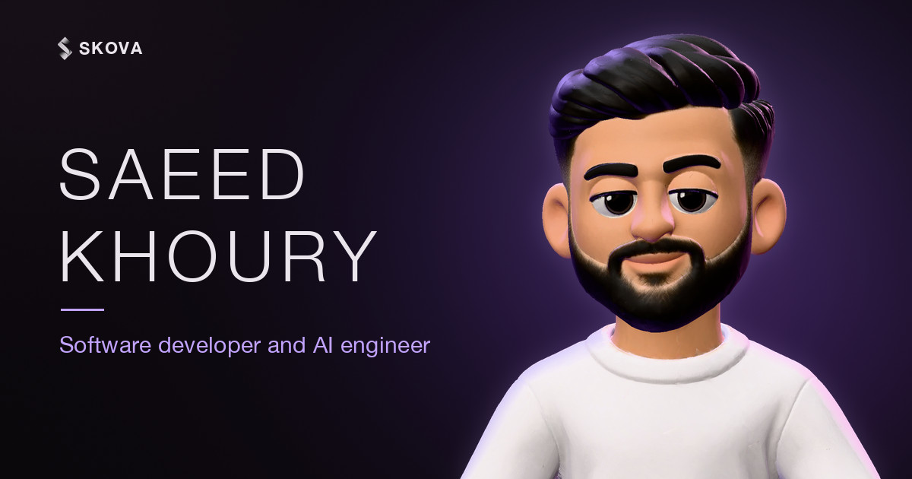

<div align="center">

<a href="https://skova.dev"></a>

# SKOVA

**The portfolio of Saeed Khoury, software developer and AI engineer.**

[**skova.dev**](https://skova.dev) · [All works](https://skova.dev/works) · [LinkedIn](https://www.linkedin.com/in/saeed-khoury-a5a119359/) · [Contact](mailto:saed.khoury10@gmail.com)

</div>

---

## Overview

SKOVA is a hand-built static portfolio. A 3D avatar sits at a desk and moves with the scroll
story, on desktops and on phones held upright. The site shows my work, the tools behind each
project, my career, and how to reach me.

It is written in plain HTML, CSS and JavaScript modules. There is no framework, no build step and
nothing to install. Every library is self-hosted, so the page does not depend on outside CDNs.

## Highlights

- **3D avatar hero.** A GLB character rendered with three.js. It types at a desk, tilts its head
  when you hover over its face, and follows a choreographed scroll timeline (GSAP ScrollTrigger and Lenis).
- **Content in one file.** Every word, project, link and image path lives in
  [`portfolio/site.config.js`](portfolio/site.config.js). The pages render from that file.
- **All Works page.** A gallery of every project, with a lightbox and a description of the tools
  used for each one.
- **Accessible by default.** Honors `prefers-reduced-motion`, falls back to a still image when 3D
  is unavailable, keeps a plain no-JavaScript version of each page, and uses semantic landmarks
  with one `h1` per page.
- **Hardened delivery.** A strict Content Security Policy, HSTS, `X-Frame-Options: DENY` and a
  locked-down Permissions Policy, set in [`portfolio/_headers`](portfolio/_headers).
- **Ready for search and AI search.** Structured data (JSON-LD), Open Graph tags, a sitemap,
  `robots.txt`, and an [`llms.txt`](portfolio/llms.txt) that tells AI models what the site is.
- **Privacy first.** No cookies, no analytics, no trackers. See the
  [privacy policy](https://skova.dev/privacy).

## Tech stack

| Area | Tools |
| --- | --- |
| Markup and style | HTML5, CSS custom properties (design tokens), Geist font |
| Scripting | Native ES modules, no bundler |
| 3D | [three.js](https://threejs.org) 0.186 with GLTFLoader |
| Motion | [GSAP](https://gsap.com) 3.15 (ScrollTrigger, SplitText), [Lenis](https://lenis.darkroom.engineering) 1.3 smooth scroll |
| Hosting | Cloudflare Workers (static assets) on a custom domain |

Pinned versions and their sources are listed in
[`portfolio/assets/vendor/VERSIONS.md`](portfolio/assets/vendor/VERSIONS.md).

## Project structure

```text
SKOVA/
├── portfolio/                 # The website (this folder is what gets deployed)
│   ├── index.html             # Home page
│   ├── works.html             # All Works page
│   ├── privacy.html           # Privacy policy
│   ├── 404.html               # Not-found page
│   ├── site.config.js         # All site content
│   ├── _headers               # Security and caching headers
│   ├── robots.txt, sitemap.xml, llms.txt
│   └── assets/
│       ├── css/               # Tokens, base styles, sections, All Works
│       ├── js/
│       │   ├── avatar/        # 3D character, stage and choreography
│       │   ├── motion/        # Scroll and section animations
│       │   ├── render/        # Builds each section from site.config.js
│       │   ├── works/         # All Works lightbox and entrance
│       │   └── util/          # DOM, environment and logging helpers
│       ├── models/            # Optimized avatar (GLB)
│       ├── img/, icons/, video/
│       └── vendor/            # Self-hosted GSAP, Lenis, three.js
└── cloudflare/
    ├── wrangler.jsonc         # Worker that serves portfolio/ at skova.dev
    └── www-redirect/          # Sends www.skova.dev to skova.dev
```

## Run it locally

Browsers do not run JavaScript modules from `file://`, so serve the folder with any static server:

```bash
cd portfolio
python3 -m http.server 8000
```

Then open <http://localhost:8000>.

Useful switches you can add to the address:

| Switch | Effect |
| --- | --- |
| `?avatar=0` | Show the still picture instead of the live 3D character |
| `?motion=reduce` | Preview the site as visitors with "reduce motion" see it |
| `?debug` | Print the site's own warnings in the browser console |

## Editing content

Open [`portfolio/site.config.js`](portfolio/site.config.js), change a value, save and refresh.
The HTML never needs editing for content. The one exception is the short no-JavaScript list in each
page's `<noscript>` block, which is updated by hand.

The full developer handbook is in [`portfolio/README.md`](portfolio/README.md). It covers the
avatar pipeline, the All Works page, branding, link previews and search engine setup.

## Deployment

The site is served by a Cloudflare Worker that uploads the `portfolio/` folder as static assets.
From the repository root:

```bash
npx wrangler@4.147.0 deploy --config cloudflare/wrangler.jsonc
```

Files listed in [`portfolio/.assetsignore`](portfolio/.assetsignore), such as the developer
README, are never uploaded.

## Credits and licenses

- [three.js](https://github.com/mrdoob/three.js) and [Lenis](https://github.com/darkroomengineering/lenis)
  are MIT licensed. Their license files ship in `portfolio/assets/vendor/`.
- [GSAP](https://gsap.com) is used under its Standard "no charge" license.
- [Geist](https://vercel.com/font) is loaded from Google Fonts.

## Copyright

© 2026 Saeed Khoury. All rights reserved.

The source code is public so it can be read and reviewed. It is not licensed for reuse. The
personal content (text, photos, avatar, CV and project screenshots) belongs to me and to the
respective clients, and may not be copied. The third-party libraries above keep their own
licenses.

## Contact

**Saeed Khoury**, software developer and AI engineer

- Website: [skova.dev](https://skova.dev)
- Email: [saed.khoury10@gmail.com](mailto:saed.khoury10@gmail.com)
- LinkedIn: [saeed-khoury](https://www.linkedin.com/in/saeed-khoury-a5a119359/)
- GitHub: [@saeedkhoury](https://github.com/saeedkhoury)
